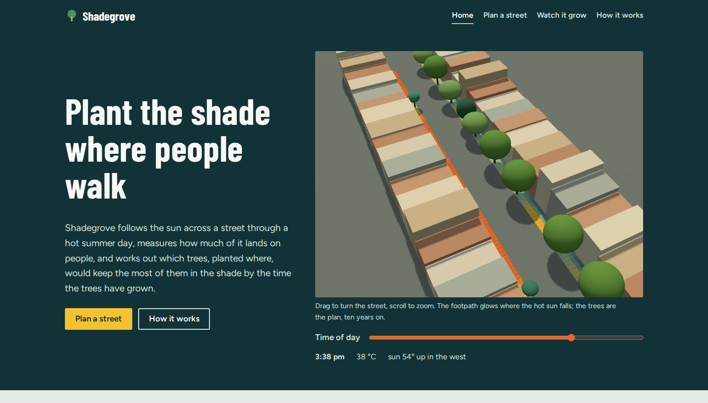
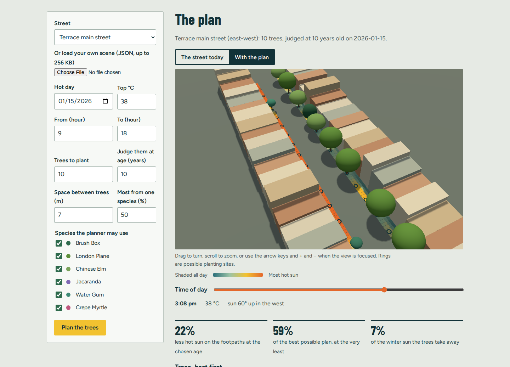
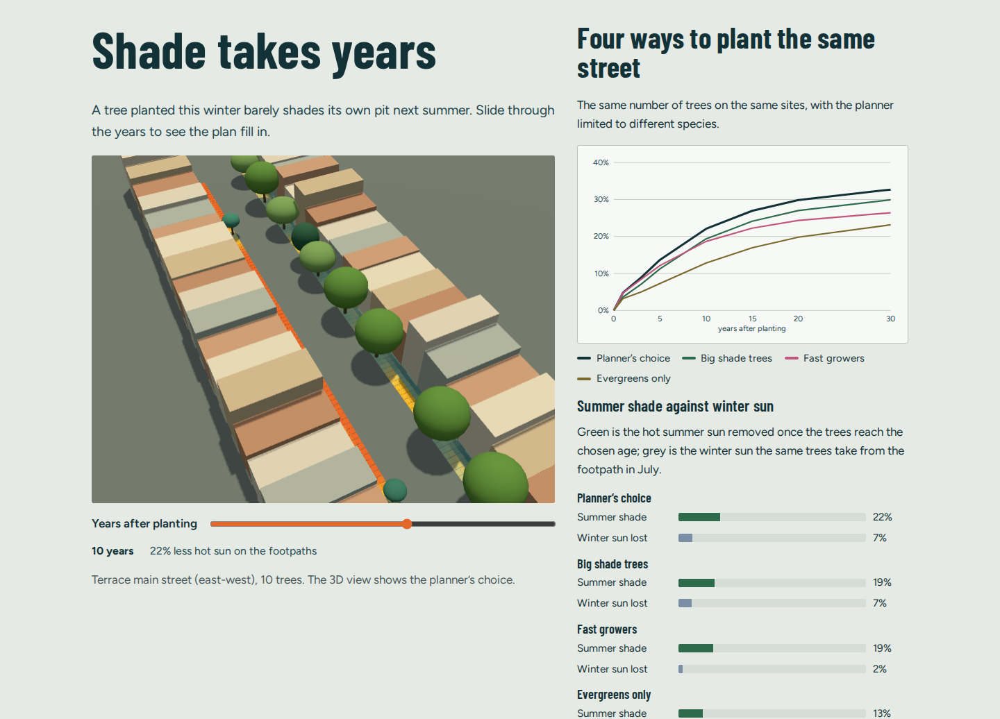
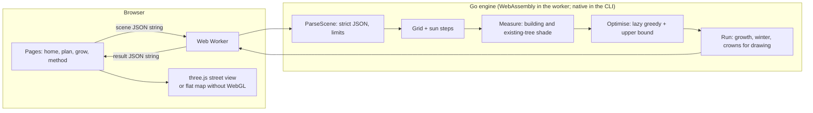

# Shadegrove

**Plant the shade where people walk.** Shadegrove follows the sun across a street through a hot summer day, measures how much of it lands on people, and works out which trees, planted where, would keep the most of them in the shade once the trees have grown. It also proves how close its plan is to the best possible one.

[](https://github.com/reihooneh/shadegrove/actions/workflows/ci.yml)


**Live demo:** https://reihooneh.github.io/shadegrove/ (everything runs in your browser).



## Why I built this

Summers in western Sydney now regularly pass 40 °C, and footpaths in full sun are where heat hits people hardest: people waiting for buses, walking to school, pushing prams. Councils plant thousands of street trees a year, but where each one goes is usually decided by gaps in a row of pits, not by where the hot afternoon sun actually falls on people. I wanted a tool that answers the planner's real question, *"with ten trees, where do I get the most shade for the most people, when it matters?"*, and that is honest about how good its answer is.

## What it does

- **Traces the sun:** every quarter of an hour for any place and date (the NOAA solar equations), with rays from shoulder height on every square metre of footpath.
- **Real shade:** buildings block the sun completely. Tree crowns are ellipsoids sized for each species' age, and the light through them fades by the Beer–Lambert law: a ray through the middle of a brush box lets through about 15% of the sun, while one grazing the edge lets through most of it.
- **Weighs what matters:** sun at 3 pm on a 38 °C day counts far more than sun at 9 am, and a busy footpath counts more than a quiet one.
- **Places trees:** one at a time, with lazy greedy selection over every site and species pair. It respects spacing, height limits under power lines, and a species-mix rule, so one pest can't take the whole street.
- **Proves the plan:** removed sun is monotone and submodular, so greedy choice is always within 63% of the best possible plan. Shadegrove also computes a ceiling for each plan from its own data and reports the plan as a share of it.
- **Shows the years and seasons:** how the shade fills in from planting day to 30 years, and how much winter sun the same trees take away (deciduous trees give most of it back).
- **Four pages:** the home page with a live 3D street, a planner (with your own scene files), a growth and season comparison of four planting strategies, and a method page whose checks run live in your browser.

| Planner | Watch it grow |
|---|---|
|  |  |

## Architecture



## Stack

- **Engine:** Go 1.24, standard library only. It is compiled to WebAssembly (`GOOS=js`) for the site and natively for the `shadegrove` command line tool.
- **Site:** plain ES modules, three.js 0.170 (self-hosted), and self-hosted Barlow Condensed and Figtree fonts. There is no framework, and it has a strict Content-Security-Policy.
- **Tests:** Go tests (the race detector, an exhaustive-search comparison, a submodularity property test, fuzzing) and Playwright browser tests at three screen sizes.
- **CI and hosting:** GitHub Actions runs lint, tests, fuzzing, a check that the committed site matches its sources, browser tests and `npm audit`, then deploys to GitHub Pages.

## Run it

```bash
npm ci                         # pinned: three, fonts, playwright
make wasm site                 # build the WebAssembly engine and the pages
npm run serve                  # http://127.0.0.1:4173/

make cli
./build/shadegrove scenes/terrace-street.json          # a text report
./build/shadegrove -json scenes/town-square.json       # the full result as JSON
```

Sample report:

```
SHADEGROVE  Terrace main street (east-west)
2026-01-15, 09:00 to 18:00, up to 38 °C. 960 footpath cells of 1 m, 36 moments with the sun up.

Plant 10 trees (best first; each gain counts only what earlier trees don't already shade):
   1. N17    London Plane   at (  39.0,    5.6)  removes   2.9% of the street's hot sun
   ...
  10. S04    Water Gum      at ( -36.0,   -5.6)  removes   1.0% of the street's hot sun

After 10 years these trees remove 22% of the heat-weighted sun on the footpaths.
No plan of 10 trees can remove more than 37%, so this one is at least 59% of the best possible.
```

A scene is a JSON file with the place, date and hours; buildings as blocks; footpaths with how busy they are; candidate planting sites (with optional height limits); and existing trees. See `scenes/` for three examples.

## Tests

```bash
make lint test        # gofmt, go vet (native and WebAssembly), Go tests with -race
make fuzz             # 30 s of fuzzing the scene parser
npm test              # browser tests (needs `make wasm site` first)
```

- **Exhaustive search:** on 40 random small streets, the greedy plan is never below (1 − 1/e) of the true best, the bound is never below it, and lazy greedy picks exactly what plain greedy picks. Greedy found the very best plan on 32 of the 40.
- **Physics:** sun positions checked against hand geometry (Sydney and London solstice noons, the equator at the equinox), plus tests for crowns, rays and growth.
- **Browser:** every page at 1440, 820 and 390 px wide, checked for no console errors, no sideways scroll, no overlapping text (HTML and SVG), and no overlapping controls, plus the main interactions, a no-WebGL fallback, and hostile links and files.

## Security

There is no server and no data collection: the site is static, and scenes you load never leave your browser. The main risks are hostile scene files and crafted links, and the defences are:

- **Strict scene parsing:** at most 256 KB, unknown fields refused, a single JSON object only, and every number range-checked and finite. Names and ids use a small character set, and error messages never repeat the input.
- **Bounded work:** caps on buildings, walks, sites and trees. The footpath grid coarsens to keep cells × moments under 300,000, and a hard cap on shade records refuses oversized scenes with an explanation rather than exhausting memory. The engine runs in a Web Worker, so the page never freezes.
- **Safe page code:** no `innerHTML` or string-built HTML (all text goes in through `textContent`), and URL fragments are whitelisted and range-checked.
- **Strict CSP:** `default-src 'none'`, scripts only from the site itself (plus `wasm-unsafe-eval` for WebAssembly), no inline scripts or styles, no third-party anything. The browser tests check this.
- **Few dependencies:** pinned and self-hosted, with `npm audit` in CI.

See [SECURITY.md](SECURITY.md) for the threat model and how to report a problem. No software is perfectly secure; this follows professional practice and says where its limits are.

## Limits

- Buildings are blocks, crowns are ellipsoids, and only direct sun is modelled, not heat reflected from walls or radiated by the road.
- Species figures are indicative; underground services, sight lines and local street-tree guides come first.
- The bound is a worst-case certificate; the true gap to the best plan is usually much smaller (see the exhaustive tests).

## Roadmap

- Import building footprints and heights from open data (OpenStreetMap) instead of drawing blocks.
- Score with a pedestrian thermal-comfort index (such as UTCI) as well as direct sun.
- Plan in stages: which trees to plant this year, given next year's budget.

## Licence

MIT. three.js (MIT), Go's `wasm_exec.js` (BSD) and the fonts (OFL) keep their own licences in `site/assets/vendor` and `site/assets/fonts`.
